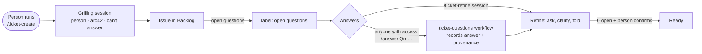

# Ticket system: refined tickets with no assumptions

Tickets are created and refined **locally** with two Copilot skills. Questions are answered either in those sessions or **on GitHub** with comment commands. A plain GitHub Action keeps everything consistent. No AI runs on GitHub for this part, and it uses no AI credits.



## Files

| File | What it is |
|---|---|
| `.github/skills/ticket-create/SKILL.md` | Skill: new ticket from a description or roadmap entry |
| `.github/skills/ticket-refine/SKILL.md` | Skill: open questions, comment answers, fold, Ready |
| `.github/ticket-system/ticket-format.md` | **The contract**: issue body layout, question blocks, provenance, labels, commands |
| `.github/ticket-system/procedures.md` | Procedures shared by both skills (asking, evidence, validation, safe writes, lanes) |
| `.github/ticket-system/config.yml` | Project board, lanes, arc42/roadmap paths, labels |
| `.github/workflows/ticket-questions.yml` | Action: `/answer`, `/ask`, `/obsolete`; label sync on every edit |
| `.github/scripts/ticket-questions/format.js` | Parser and editor for the format (pure, unit-tested) |
| `.github/scripts/ticket-questions/main.js` | GitHub glue for the workflow |
| `.github/scripts/ticket-questions/check.js` | Validator CLI the skills run before every write |
| `.github/scripts/ticket-questions/*.test.js` | `node --test .github/scripts/ticket-questions/*.test.js` (Node 18+) |

## Setup

1. **Copy the files** into the repository. Edit `config.yml`: project owner and number, lane names (exact, case-sensitive), arc42 and roadmap paths.
2. **Developers:**
   - `gh auth login`
   - `gh auth refresh -s project` (for lane moves)
   - Node 18+ (for `check.js`)
3. **Run the skills in Copilot:** `/ticket-create`, `/ticket-refine 42`. Copilot reads skills from `.github/skills/`.
4. **Board view.** Add a saved view "Ready to refine": lane = Backlog, label ≠ `open questions`.
5. **Outside collaborators** who should answer questions need **Read** access to the repo (private repos). That is enough to comment.

## Comment commands (on the issue)

```text
/answer Q2
Up to 50,000 rows. Above that, ask the user to narrow the filter.

/ask Which date format does the CSV use?
We have users in the US and the EU.

/obsolete Q3
Attachments move to the new storage service, covered by #57.
```

- **Who may use them:** only the repository owner, organization members and collaborators.
  - `/answer` and `/ask` need read access or higher, so outsiders must be added as collaborators.
  - `/obsolete` needs write access or higher.
- **Several commands per comment.** **All are applied, or none are.** Errors are explained in a reply.
- **Answers are never overwritten.** To correct an answer, `/ask` a question that names the one it corrects (*"Q2 corrected: …"*); the next `ticket-refine` links them.
- **Feedback.** The workflow reacts 👍 on success and comments when the last open question is resolved.
- **Later edits.** Editing a comment afterwards does not change the recorded answer; the comment link keeps GitHub's edit history.

## Guarantees and limits

| Guarantee | How |
|---|---|
| `open questions` label always matches the ticket | The Action runs on every issue edit, label change and command. A label removed by hand comes back |
| A hand-edited body can't silently close a question | Fail closed: the label stays on and `ticket-format-error` is added if a marker is malformed, a status is flipped without the required fields, or a question is deleted (gaps in IDs, or IDs missing compared with the previous version) |
| No ticket with open questions reaches the AI implementation workflow | The `ai-ready` claim job skips issues with `open questions` (add this condition to the claim job) |
| Skills never move a ticket to Ready with open questions or unfolded answers | The skills only offer Ready when `check.js` reports `readyAllowed: true`, and the person must confirm |
| No statement without a source | `check.js` rejects any prose line without a trace token, and any `[Qn]` pointing to an open, obsolete or superseded question |
| Concurrent answers never overwrite each other | Workflow concurrency per issue (`queue: max`); skills re-read before writing |
| **Not** guaranteed | A human dragging a card to Ready, or a ticket staying in Ready after a later `/ask`. Moving a card triggers no workflow, and lane moves need a project token. The workflow comments when `/ask` reopens a ticket, and `ticket-refine` moves such tickets back. A scheduled scan with a project token could do this automatically (follow-up) |
| **Not** prevented | Someone with write access hand-forging a complete answered block. GitHub's issue edit history shows who did it |

## Notes

- **actionlint 1.7.12** reports `queue` under `concurrency` as unknown. That key is a recent GitHub Actions addition, and gh-aw emits it in its own lock files; the rest of the workflow passes actionlint.
- **Labels written with `GITHUB_TOKEN`** (by the workflow) don't trigger other workflows. That is intended; the workflow sets every label it needs itself.
- **Agents can't use the commands.** An agentic workflow posting `/ask` as `github-actions[bot]` triggers nothing, and bot comments are ignored on purpose. Agents report gaps in their own output instead.
