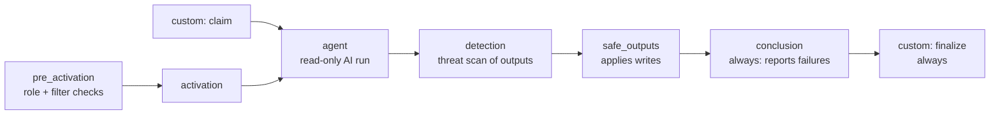
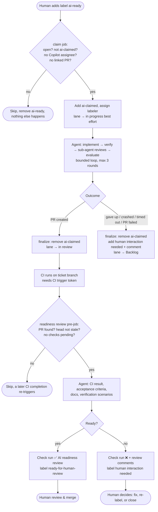
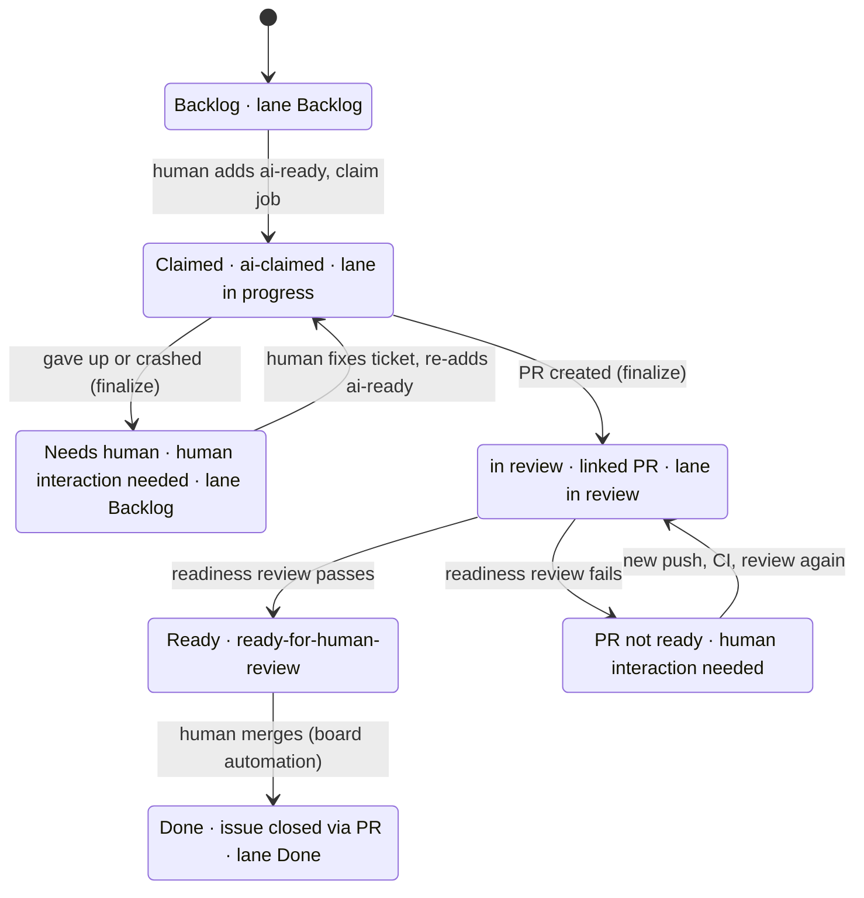

# AI ticket pipeline on GitHub Agentic Workflows

**Proposal for team discussion** · drafted 2026-10-08 · status: design, nothing built or compiled yet

> **Update 2026-10-09:** lane names follow the board: `Backlog`, `Ready`, `in progress`, `in review`, `Done`. The claim job also skips tickets with the `open questions` label. Ticket creation and refinement (`ticket-create`, `ticket-refine`, `/answer`) are specified in `.github/ticket-system/`.

---

## TL;DR

We add two agentic workflows to a Copilot-based repository:

1. **`ticket-implement`**: a human adds the label `ai-ready` to an issue. The workflow claims the ticket and runs our implement → verify → review loop (the loop from `/ticket:pick`), with reviewer sub-agents in their own context. It then either opens a PR and moves the ticket to the **in review** lane, or hands it back with `human interaction needed` and moves it to **Backlog**.
2. **`ticket-readiness-review`**: when CI finishes on a ticket branch, a second, independent run checks whether the PR is ready for a human. That means CI green, the ticket fully implemented, docs updated, and verification scenarios present. The result is reported as a **status check** (which can be made required), a PR review, and labels.

Both run on the **Copilot engine**, billed to the **organisation's** Copilot AI Credits. The agent never has write access. Every write goes through allow-listed "safe outputs" or small deterministic jobs we write ourselves.

The decisions we need from the team are collected in [§ 11 Open questions](#11-open-questions-for-the-team).

---

## Contents

1. [Background: what GitHub Agentic Workflows are](#1-background-what-github-agentic-workflows-are)
2. [End-to-end overview](#2-end-to-end-overview)
3. [Workflow 1: `ticket-implement`](#3-workflow-1-ticket-implement)
4. [Workflow 2: `ticket-readiness-review`](#4-workflow-2-ticket-readiness-review)
5. [Labels, lanes and the state model](#5-labels-lanes-and-the-state-model)
6. [Credentials and secrets](#6-credentials-and-secrets)
7. [Cost and billing](#7-cost-and-billing)
8. [Security model](#8-security-model)
9. [How this maps to `/ticket:pick`](#9-how-this-maps-to-ticketpick)
10. [Rollout plan](#10-rollout-plan)
11. [Open questions for the team](#11-open-questions-for-the-team)
12. [Known uncertainties to verify](#12-known-uncertainties-to-verify)
13. [References](#13-references)

---

## 1. Background: what GitHub Agentic Workflows are

**GitHub Agentic Workflows** (`gh-aw`) is an open-source `gh` CLI extension maintained by GitHub Next. It runs AI agents inside GitHub Actions.

- **One file per workflow.** A workflow is a single Markdown file in `.github/workflows/<name>.md`. YAML frontmatter holds triggers, permissions, tools, engine and outputs. The Markdown body holds the natural-language instructions.
- **Compiled to Actions.** `gh aw compile` validates the file and generates `<name>.lock.yml`, a normal GitHub Actions workflow. **Both files are committed.** Editing the `.md` without recompiling has no effect.
- **Engines.** Copilot (default), Claude Code, Codex, Gemini and Pi. We use **Copilot**.
- **Deterministic work stays deterministic.** Builds, tests and lint stay in normal CI. Agentic workflows handle work that needs judgement.

### Core concepts

| Concept | What it means for us |
|---|---|
| **Agent job** | The job where the AI runs. **Read-only.** It can read the repo, edit files in its own checkout, and run allow-listed shell commands. It cannot write to GitHub. |
| **Safe outputs** | The only way the agent changes anything on GitHub. The agent *requests* actions (create PR, add label, comment, …). A separate job with write permissions applies them **after** the agent has finished, and only within the limits and allowlists we configure. |
| **Threat detection** | A built-in `detection` job inspects the agent's requested outputs before the `safe_outputs` job is allowed to run. |
| **Custom jobs** | Normal Actions jobs we add in frontmatter (`jobs:`). They can run **before** the agent (e.g. our claim), or **after everything** with `needs: [conclusion]` + `if: always()` (e.g. our finalize). Each has its own `permissions`. |
| **Conclusion job** | Built-in last job. It runs with `always()` semantics and reports failures (by default it opens a failure issue). |
| **Sub-agents** | Named agents the main agent can call. Each runs in its own context and returns only its reply. For Copilot they live in `.github/agents/<name>.agent.md`, or can be defined inline in the workflow file. |
| **Runtime imports** | `{{#runtime-import path}}` pulls a Markdown file from inside `.github/` into the prompt at run time. This keeps workflow files short and the prompts versioned next to the code. |

### Generated job pipeline (per run)



---

## 2. End-to-end overview



### Who does what

| Actor | Responsibility |
|---|---|
| Human (write role or higher) | Writes a good ticket, adds `ai-ready`, reviews the PR, merges, handles `human interaction needed` |
| `ticket-implement` | Claims, implements, self-reviews with sub-agents, opens the PR or hands back |
| CI (existing) | Builds and tests the PR as usual |
| `ticket-readiness-review` | Independent pre-review gate before a human spends time on the PR |
| Project board | Mirror of state for people. **Never the source of truth** (see § 5) |

---

## 3. Workflow 1: `ticket-implement`

### 3.1 Trigger

```yaml
on:
  issues:
    types: [labeled]
    names: [ai-ready]
  roles: [admin, maintainer, write]   # gh-aw default, stated explicitly
```

- Only users with **write access or higher** can trigger it. This is gh-aw's default role check; failed checks cancel the run.
- We use a plain `labeled` trigger with a `names:` filter, **not** `label_command`. The claim job removes `ai-ready` itself, so the label is always consumed, whether the ticket is claimed or skipped.
- `workflow_dispatch` can be added for manual test runs.

### 3.2 Claim: the lock

**Why a custom job?** The agent is read-only, and safe outputs are applied *after* the agent finishes. So the agent cannot claim a ticket before it starts working. A custom job runs before the agent with `issues: write` and does the claim deterministically.

**Why not the project lane?** Lanes live in GitHub Projects (v2). The default `GITHUB_TOKEN` cannot read or write Projects at all; that needs a separate PAT or App token. Lane changes also do not trigger workflows. The lock therefore lives on the **issue** (a label), which `GITHUB_TOKEN` can handle. The lane is a best-effort mirror.

**Claim rules.** The job reads the **live** issue state (not the event payload) and skips if any of these hold:

| Condition | Why |
|---|---|
| Issue is closed | Nothing to do |
| Has `ai-claimed` | Another run owns it, or one is in progress |
| Has `open questions` | The ticket isn't refined yet; no AI may work on it (see the ticket system in `.github/ticket-system/`) |
| Copilot is an assignee | The Copilot cloud agent is already working on it; two agents on one ticket means double cost and conflicting PRs |
| A PR already links to the issue (`Fixes #N` / `Closes #N`) | Already implemented; prevents re-picking a ticket that sits in *in review* |

Otherwise it does the following:

- Adds `ai-claimed`.
- Removes `human interaction needed` if present (a human handed it back on purpose).
- Assigns the person who added the label, so there is an accountable human and a `claimed_at` timestamp for `/ticket:pick`'s stale-claim check.
- Moves the lane to **in progress**, best effort.

**Why we never assign Copilot as the claim.** Assigning Copilot to an issue *starts the Copilot cloud agent*, which would implement the ticket in parallel with our workflow.

**Race protection.**

- `concurrency: ticket-<issue number>`, `cancel-in-progress: false`. Two quick label events are serialized, and the second sees `ai-claimed` and skips.
- Label edits made with `GITHUB_TOKEN` **do not trigger other workflows** (GitHub suppresses them), so the claim cannot cascade.

```yaml
jobs:
  claim:
    runs-on: ubuntu-latest
    permissions:
      issues: write
    outputs:
      claimed: ${{ steps.claim.outputs.claimed }}
    steps:
      - uses: actions/checkout@v5            # for .github/scripts/
      - id: claim
        env:
          GH_TOKEN: ${{ github.token }}
          REPO: ${{ github.repository }}
          ISSUE: ${{ github.event.issue.number }}
          SENDER: ${{ github.event.sender.login }}
        run: |
          s=$(gh issue view "$ISSUE" -R "$REPO" \
                --json state,labels,assignees,closedByPullRequestsReferences)
          gh issue edit "$ISSUE" -R "$REPO" --remove-label ai-ready
          if jq -e '.state != "OPEN"
                    or ([.labels[].name] | index("ai-claimed"))
                    or ([.labels[].name] | index("open questions"))
                    or ([.assignees[].login | ascii_downcase] | index("copilot"))
                    or (.closedByPullRequestsReferences | length > 0)' <<<"$s" >/dev/null; then
            echo "::notice::closed, already claimed, has open questions, owned by Copilot, or already has a PR. Skipping."
            echo "claimed=false" >> "$GITHUB_OUTPUT"; exit 0
          fi
          gh issue edit "$ISSUE" -R "$REPO" --add-label ai-claimed --remove-label "human interaction needed"
          gh issue edit "$ISSUE" -R "$REPO" --add-assignee "$SENDER" \
            || echo "::warning::could not assign $SENDER, label-only claim"
          echo "claimed=true" >> "$GITHUB_OUTPUT"
      - name: Lane → in progress (best effort)
        if: steps.claim.outputs.claimed == 'true'
        continue-on-error: true
        env:
          PROJECT_TOKEN: ${{ secrets.GH_AW_WRITE_PROJECT_TOKEN }}
          PROJECT_OWNER: my-org
          PROJECT_NUMBER: "1"
          REPO: ${{ github.repository }}
        run: .github/scripts/move-lane.sh "${{ github.event.issue.number }}" "in progress"

  agent:                                     # gate the generated agent job
    needs: [claim]
    if: needs.claim.outputs.claimed == 'true'
```

> Note on `jq`: `index()` returns `0` for a first-position match, and `0` is truthy in jq (only `false`/`null` are falsy), so the `or` chain behaves as intended.

### 3.3 The agent: running the loop headless

The prompt lives in the repo, not in the workflow file:

```markdown
{{#runtime-import shared/ticket-implement-loop.md}}
```

`.github/shared/ticket-implement-loop.md` is a **headless variant of `/ticket:pick` steps 2–6**. It is a separate file because `pick.md` has hard rules (interactive gates, atomic claim via the engine) that contradict CI.

| `/ticket:pick` step | Headless behaviour |
|---|---|
| Step 2: read current state | Read the issue (body, acceptance criteria, `## Non-functional requirements`) and referenced files |
| Step 3: plan + `challenger` | Plan is written and challenged by the `challenger` sub-agent. **No approval gate:** the plan goes into the PR description. If the challenger shows the ticket is ambiguous or contradictory → stop, hand back with `human interaction needed` and the open questions as a comment |
| Steps 4–5: implement + verify | Edit files, run `verification.test_commands` (must be allow-listed in `tools.bash`) |
| Step 5.5: agent checks | Call sub-agents in parallel or sequence: `code-reviewer`, `test-adequacy-reviewer` (blocking), `code-challenger`, `code-simplifier` (advisory). Check each reply with `te agent reply-check` |
| Step 5.7: evaluate | Same precedence: re-plan → escalate → iterate → done. Max `verification.max_loop_rounds` (default 3) |
| Re-plan / escalation gate | **No human to ask** → hand back: `human interaction needed` + comment with findings, loop log and what was tried |
| Step 6: sign-off report | Becomes the **PR body**: what landed, tests, agent verdicts, loop log, **verification checklist for the human reviewer** |

**Sub-agents.** For the Copilot engine, sub-agents are `.github/agents/<name>.agent.md`. Our template's init already generates these Copilot adapters (`scripts/gen-adapters.sh`) for all six agents (`challenger`, `code-challenger`, `code-reviewer`, `code-simplifier`, `nfr-analyst`, `test-adequacy-reviewer`). Each runs in its own context and returns only its reply. gh-aw runs a smoke test for Copilot sub-agents (`smoke-copilot-sub-agents.md`), including sub-agents on different models via a `model:` field. Agents can alternatively be defined inline in the workflow (`## agent: \`name\`` … `## end agent: \`name\``), but we keep them in the repo.

**Branch naming.** The agent names its branch `ticket/<id>-<slug>` (our engine's convention). `preserve-branch-name: true` stops gh-aw from adding a random suffix. The readiness review's trigger depends on this prefix.

### 3.4 Safe outputs (what the agent may request)

```yaml
safe-outputs:
  create-pull-request:
    preserve-branch-name: true      # keep ticket/<id>-<slug>
    # auto-close-issue: true (default) → adds "Fixes #N", which the claim and finalize jobs rely on
    # CI trigger token: picked up automatically from secret GH_AW_CI_TRIGGER_TOKEN
  add-labels:
    allowed: ["human interaction needed"]
    max: 1
  add-comment:
    max: 2
```

- Labels must **exist** in the repo beforehand. `add-labels` rejects unknown labels unless `create-if-missing: true` is set. All labels from § 5.2 are created once during setup.
- The agent **cannot** touch `ai-claimed`, lanes, assignees or any other label. Those are owned by our deterministic jobs.
- The agent never sees the project token.

### 3.5 Finalize: deterministic end state, even on crash

The agent cannot be trusted to clean up after itself: a crash, timeout, or failed PR creation would leave the ticket locked forever. So a custom job runs **after everything**, regardless of outcome. gh-aw documents `needs: [conclusion]` + `if: always()` for exactly this.

| Live state after the run | Path |
|---|---|
| Agent job `success` **and** a PR links to the issue **and** agent did not set `human interaction needed` | **Success:** remove `ai-claimed`, lane → **in review** |
| Anything else (agent gave up, crashed, timed out, safe outputs failed, PR missing) | **Hand back:** remove `ai-claimed`, ensure `human interaction needed`, comment with run link if the agent didn't explain, lane → **Backlog** |

```yaml
jobs:
  finalize:
    needs: [claim, agent, conclusion]
    if: always() && needs.claim.outputs.claimed == 'true'
    runs-on: ubuntu-latest
    permissions:
      issues: write
    steps:
      - uses: actions/checkout@v5
      - env:
          GH_TOKEN: ${{ github.token }}
          PROJECT_TOKEN: ${{ secrets.GH_AW_WRITE_PROJECT_TOKEN }}
          PROJECT_OWNER: my-org
          PROJECT_NUMBER: "1"
          REPO: ${{ github.repository }}
          ISSUE: ${{ github.event.issue.number }}
          AGENT_RESULT: ${{ needs.agent.result }}
          RUN_URL: ${{ github.server_url }}/${{ github.repository }}/actions/runs/${{ github.run_id }}
        run: |
          s=$(gh issue view "$ISSUE" -R "$REPO" --json labels,closedByPullRequestsReferences)
          asked=$(jq '[.labels[].name] | index("human interaction needed") != null' <<<"$s")
          prs=$(jq '.closedByPullRequestsReferences | length' <<<"$s")

          if [ "$AGENT_RESULT" = success ] && [ "$prs" -gt 0 ] && [ "$asked" = false ]; then
            gh issue edit "$ISSUE" -R "$REPO" --remove-label ai-claimed
            .github/scripts/move-lane.sh "$ISSUE" "in review" || echo "::warning::lane not moved"
          else
            gh issue edit "$ISSUE" -R "$REPO" --remove-label ai-claimed --add-label "human interaction needed"
            [ "$asked" = true ] || gh issue comment "$ISSUE" -R "$REPO" \
              --body "AI implementation did not finish (agent job: $AGENT_RESULT). Run: $RUN_URL"
            .github/scripts/move-lane.sh "$ISSUE" "Backlog" || echo "::warning::lane not moved"
          fi
```

### 3.6 Lane helper: `.github/scripts/move-lane.sh` (draft)

This script is shared by both workflows and by any future one. It uses the Projects **REST** routes documented in our ticket engine (§ GitHub Projects sync), not `gh project`, which is expensive on the GraphQL budget.

```bash
#!/usr/bin/env bash
# usage: move-lane.sh <issue-number> "<lane name>"
# env:   PROJECT_TOKEN, PROJECT_OWNER, PROJECT_NUMBER, REPO
#        optional: STATUS_FIELD (default "Status"), OWNER_KIND (orgs|users, default orgs)
set -euo pipefail
issue="$1"; lane="$2"
: "${PROJECT_TOKEN:?}" "${PROJECT_OWNER:?}" "${PROJECT_NUMBER:?}" "${REPO:?}"
export GH_TOKEN="$PROJECT_TOKEN"
base="${OWNER_KIND:-orgs}/$PROJECT_OWNER/projectsV2/$PROJECT_NUMBER"

field=$(gh api "$base/fields" --jq ".[] | select(.name == \"${STATUS_FIELD:-Status}\")")
field_id=$(jq -r '.id' <<<"$field")
option_id=$(jq -r --arg l "$lane" '.options[] | select(.name.raw == $l) | .id' <<<"$field")
[ -n "$option_id" ] || { echo "lane '$lane' not found on board" >&2; exit 1; }

url="https://github.com/$REPO/issues/$issue"
item_id=$(gh api --paginate "$base/items?per_page=100" \
            --jq ".[] | select(.content.html_url == \"$url\") | .id" | head -n1)
if [ -z "$item_id" ]; then                       # not on the board yet → add it
  issue_id=$(gh api "repos/$REPO/issues/$issue" --jq .id)
  item_id=$(gh api --method POST "$base/items" --input - <<<"{\"type\":\"Issue\",\"id\":$issue_id}" --jq .id)
fi

gh api --method PATCH "$base/items/$item_id" \
  --input - <<<"{\"fields\":[{\"id\":$field_id,\"value\":\"$option_id\"}]}" >/dev/null
echo "issue #$issue → $lane"
```

Every call site uses `continue-on-error` or `|| echo ::warning::`. A missing token or a renamed lane must never break a run; the board just lags behind.

### 3.7 Failure modes

| What goes wrong | What happens | Ticket ends up |
|---|---|---|
| Ticket unclear / contradictory | Agent stops early, comments its open questions | `human interaction needed`, Backlog |
| Tests can't go green within 3 rounds | Agent hands back with loop log | `human interaction needed`, Backlog |
| Reviewer says plan is wrong (`ROUTE-WRONG`) | Agent hands back (no auto re-plan) | `human interaction needed`, Backlog |
| Agent crashes / times out / AI credit cap hit | No safe outputs; finalize catches it and comments the run link | `human interaction needed`, Backlog |
| PR creation fails (e.g. patch too big) | Finalize sees no linked PR | `human interaction needed`, Backlog |
| Project token missing / lane renamed | Warning in log, board not updated | Correct labels, stale lane |
| Label added twice quickly | Second run serialized, sees `ai-claimed`, skips | Unaffected |
| Ticket assigned to Copilot | Skipped at claim | Unaffected |
| Finalize itself fails (rare: API outage) | Ticket keeps `ai-claimed` | Shows as stale claim in `/ticket:pick` after `claim.stale_after` (24h) |

gh-aw's conclusion job additionally opens a **failure issue** for failed runs by default (`report-failure-as-issue`, expires after 7 days). We should decide whether we want those or rely on our own comment.

### 3.8 Full frontmatter sketch: `.github/workflows/ticket-implement.md`

> Sketch, **not compiled**. Field names are taken from the gh-aw docs as of October 2026; run `gh aw compile` and fix what it reports.

```markdown
---
description: Implement a ticket labeled ai-ready and open a PR, or hand it back
on:
  issues:
    types: [labeled]
    names: [ai-ready]
  roles: [admin, maintainer, write]
  workflow_dispatch:
engine: copilot
permissions:
  contents: read
  issues: read
  pull-requests: read
  copilot-requests: write          # org billing
concurrency:
  group: ticket-${{ github.event.issue.number }}
  cancel-in-progress: false
timeout-minutes: 60                # agentic step (default 20 is too short for 3 rounds)
max-ai-credits: 1000               # per run (default 1000), tune after pilot
max-daily-ai-credits: 5000         # per workflow per 24h (default 5000), tune after pilot
network:
  allowed: [defaults, node]        # + our package ecosystems
tools:
  edit:
  bash:
    - ".agents/scripts/te *"       # reply-check etc. (path depends on bundle)
    - "npm ci"
    - "npm test"
    - "git *"
  github:
    toolsets: [repos, issues, pull_requests]
safe-outputs:
  create-pull-request:
    preserve-branch-name: true
  add-labels:
    allowed: ["human interaction needed"]
    max: 1
  add-comment:
    max: 2
jobs:
  claim:     { … see 3.2 … }
  agent:
    needs: [claim]
    if: needs.claim.outputs.claimed == 'true'
    timeout-minutes: 75
  finalize:  { … see 3.5 … }
---

Ticket: #${{ github.event.issue.number }}

{{#runtime-import shared/ticket-implement-loop.md}}
```

---

## 4. Workflow 2: `ticket-readiness-review`

### 4.1 Purpose

An **independent** run reviews the PR in a fresh context, seeing only the ticket, the diff and the CI results. The implementer never grades its own work. This is the same principle as our read-only reviewer sub-agents, applied at workflow level. Its job is to answer one question before a human spends time: **is this PR ready for human review?**

### 4.2 Trigger: after CI, not on PR open

"Are all checks green?" can only be answered after CI has finished. So we trigger on **CI completion on a ticket branch**:

```yaml
on:
  workflow_run:
    workflows: ["CI"]            # exact names of our CI workflows
    types: [completed]
    branches: ["ticket/**"]      # git.branch_prefix
  label_command: ai-review       # manual re-run; label is removed automatically
```

- **Runs right after implementation.** PR created → CI runs → review runs.
- **Re-runs after every new push**, because every push re-runs CI.
- **Prerequisite: CI must run on the AI's PR at all.** PRs created with `GITHUB_TOKEN` do not trigger CI. gh-aw fixes this with the secret **`GH_AW_CI_TRIGGER_TOKEN`** (fine-grained PAT with *Contents: Read & Write*, or an App). When it is present, gh-aw pushes an extra empty commit with that identity so `push`/`pull_request` CI starts. **Without it there is no CI, and therefore no review.**
- **Built-in protections.** gh-aw adds repository-ID and fork checks to `workflow_run` triggers automatically.
- **Several CI workflows.** `workflow_run` fires once per completed workflow. The pre-job (below) only lets the review through when **no checks are still pending**, so effectively the *last* CI workflow to finish triggers the real review.

### 4.3 Deterministic pre-job (no AI)

Anything that can be checked with a script is checked with a script. That is cheaper, and the AI cannot be talked into a "pass".

| Check | Source | Effect |
|---|---|---|
| Which PR? | `github.event.workflow_run.pull_requests[0].number` (or the labeled PR) | No PR → skip |
| Stale? | PR head SHA ≠ `workflow_run.head_sha` | Skip: a newer run will come |
| Checks still pending? | `gh pr checks <pr> --json name,bucket` | Skip: the last CI completion triggers again |
| CI result | Same, `bucket` = pass / fail / skipping / cancel | Passed into the prompt as facts |

```yaml
jobs:
  precheck:
    runs-on: ubuntu-latest
    permissions:
      pull-requests: read
      checks: read
      actions: read
    outputs:
      run: ${{ steps.p.outputs.run }}
      pr: ${{ steps.p.outputs.pr }}
      ci: ${{ steps.p.outputs.ci }}
    steps:
      - id: p
        env:
          GH_TOKEN: ${{ github.token }}
          REPO: ${{ github.repository }}
          PR_FROM_RUN: ${{ github.event.workflow_run.pull_requests[0].number }}
          PR_FROM_LABEL: ${{ github.event.pull_request.number }}
          RUN_SHA: ${{ github.event.workflow_run.head_sha }}
        run: |
          pr="${PR_FROM_RUN:-$PR_FROM_LABEL}"
          [ -n "$pr" ] || { echo "run=false" >> "$GITHUB_OUTPUT"; exit 0; }
          head=$(gh pr view "$pr" -R "$REPO" --json headRefOid -q .headRefOid)
          if [ -n "$RUN_SHA" ] && [ "$RUN_SHA" != "$head" ]; then
            echo "::notice::stale CI run"; echo "run=false" >> "$GITHUB_OUTPUT"; exit 0
          fi
          checks=$(gh pr checks "$pr" -R "$REPO" --json name,bucket \
                     | jq '[.[] | select(.name != "AI readiness review")]')
          if jq -e 'any(.[]; .bucket == "pending")' <<<"$checks" >/dev/null; then
            echo "::notice::checks still pending"; echo "run=false" >> "$GITHUB_OUTPUT"; exit 0
          fi
          ci=$(jq -r 'if all(.[]; .bucket == "pass" or .bucket == "skipping") then "green" else "red" end' <<<"$checks")
          { echo "run=true"; echo "pr=$pr"; echo "ci=$ci"; } >> "$GITHUB_OUTPUT"

  agent:
    needs: [precheck]
    if: needs.precheck.outputs.run == 'true'
```

### 4.4 What the agent checks

| # | Check | How | Who |
|---|---|---|---|
| 1 | **CI green** | Fact from the pre-job. If red: summarize *which* checks failed (via the `actions` toolset: run and job logs), skip the deep review, fail the check | Pre-job + agent |
| 2 | **Ticket fully implemented** | Read the linked issue's acceptance criteria and `## Non-functional requirements`. For **each** criterion, cite evidence: file/line in the diff and the test that proves it. Any criterion without evidence → not ready | Agent + `test-adequacy-reviewer` sub-agent |
| 3 | **Code quality** | Normal review of the diff against `references.architecture` / `references.conventions` | `code-reviewer` sub-agent |
| 4 | **Docs up to date** | Does the diff change public behaviour, config, CLI flags, APIs, env vars, or user-visible UI without a matching docs/README/CHANGELOG change? | Agent |
| 5 | **Verification scenarios for the human** | Does the PR body contain the verification checklist (golden path, 2–3 edge cases, regression watch)? Is every acceptance criterion covered by at least one scenario? Are steps imperative and observable? | Agent |
| 6 | **Scope** | Does the diff stay inside the ticket? Unrelated changes flagged | Agent |
| 7 | **Hygiene** | Leftover debug code, TODOs added without tickets, commented-out code, secrets in diff | Agent |

The prompt lives at `.github/shared/ticket-readiness-review.md` (runtime-imported), with an explicit output contract. Each check is `PASS` / `FAIL` / `N/A` with one line of evidence, followed by one overall verdict.

### 4.5 Outputs

```yaml
safe-outputs:
  create-check-run:
    name: "AI readiness review"
    target: "*"                     # workflow_run is not a PR event → agent names the PR
  submit-pull-request-review:
    target: "*"
    allowed-events: [COMMENT, REQUEST_CHANGES]   # the AI can never APPROVE
  create-pull-request-review-comment:
    max: 10
  add-labels:
    allowed: [ready-for-human-review, "human interaction needed"]
    target: "*"
  remove-labels:
    allowed: [ready-for-human-review, "human interaction needed"]
    target: "*"
```

- **Check run (most important).** "AI readiness review" appears as a normal status check on the PR head. Its summary holds the full check table from § 4.4. It can be made a **required status check** in a branch ruleset, so nothing merges until it is green. We would only do that after the pilot.
- **PR review with inline comments.** Points at specific lines ("acceptance criterion 3 has no test", "README still documents the old flag"). `REQUEST_CHANGES` is optional (see § 11).
- **Labels.** `ready-for-human-review` on pass; `human interaction needed` on fail. A stale label from a previous run is removed.

### 4.6 Report only, or also fix?

**Recommendation: report only, never push code.** If the reviewer pushed fixes (`push-to-pull-request-branch`), the push would re-run CI, which would re-run the review. That is an unbounded loop, and every iteration is billed.

The one tempting exception is **missing verification scenarios**. They are PR *text*, not code. `update-pull-request` could fill them in without restarting CI. This is a team decision (§ 11).

### 4.7 Lane on failure

The implementation's finalize has already moved the ticket to **in review**. On a failed readiness review, the recommendation is to **leave the lane in in review** and add `human interaction needed` plus the red check, so the PR context isn't lost. The alternative is an extra lane **AI review** that the ticket only leaves when the readiness review passes. That alternative would also require the implementation finalize to move tickets to *AI review* instead of *in review*.

### 4.8 Full frontmatter sketch: `.github/workflows/ticket-readiness-review.md`

> Sketch, **not compiled**.

```markdown
---
description: Independent readiness review of a ticket PR after CI completes
on:
  workflow_run:
    workflows: ["CI"]
    types: [completed]
    branches: ["ticket/**"]
  label_command: ai-review
engine: copilot
permissions:
  contents: read
  issues: read
  pull-requests: read
  actions: read
  checks: read
  copilot-requests: write
timeout-minutes: 30
max-ai-credits: 500
max-daily-ai-credits: 5000
tools:
  github:
    toolsets: [repos, issues, pull_requests, actions]
safe-outputs:
  create-check-run:
    name: "AI readiness review"
    target: "*"
  submit-pull-request-review:
    target: "*"
    allowed-events: [COMMENT, REQUEST_CHANGES]
  create-pull-request-review-comment:
    max: 10
  add-labels:
    allowed: [ready-for-human-review, "human interaction needed"]
    target: "*"
  remove-labels:
    allowed: [ready-for-human-review, "human interaction needed"]
    target: "*"
jobs:
  precheck: { … see 4.3 … }
  agent:
    needs: [precheck]
    if: needs.precheck.outputs.run == 'true'
---

PR: #${{ needs.precheck.outputs.pr }} · CI: ${{ needs.precheck.outputs.ci }}

{{#runtime-import shared/ticket-readiness-review.md}}
```

---

## 5. Labels, lanes and the state model

### 5.1 Principle

**Labels on the issue are the source of truth. The project lane is a mirror for people.**

- Labels are repo-scoped and work with the default `GITHUB_TOKEN`.
- Lanes need a separate Projects token, and lane changes cannot trigger workflows.

This matches our ticket engine, where board sync is "best-effort, never authoritative".

### 5.2 Labels

| Label | Meaning | Set by | Removed by |
|---|---|---|---|
| `ai-ready` | Request: "AI, please implement this" | Human | Claim job (always, claimed or not) |
| `ai-claimed` | **Lock:** an AI run currently owns this ticket | Claim job | Finalize job (both paths); a human only in emergencies |
| `human interaction needed` | AI stopped, or the PR isn't ready; a human must act | Agent (safe output), finalize, readiness review | Claim job (on re-claim), readiness review (on pass), human |
| `ready-for-human-review` | Readiness review passed on the current head | Readiness review | Readiness review (on a later fail) |
| `ai-review` *(on PRs)* | Command: re-run the readiness review | Human | gh-aw automatically (`label_command`) |

### 5.3 Ticket lifecycle



### 5.4 Lanes

| Lane | Moved by |
|---|---|
| Backlog | Human; finalize (hand-back path) |
| in progress | Claim job |
| in review | Finalize (success path) |
| Done | **Built-in project automation** "item closed → Done". The PR's `Fixes #N` closes the issue on merge |

---

## 6. Credentials and secrets

| Secret / permission | Used by | Why | Scope |
|---|---|---|---|
| `permissions: copilot-requests: write` | Agent in both workflows | Copilot inference billed to the org; no PAT needed | Per run, minted automatically |
| `GITHUB_TOKEN` | Claim, finalize, precheck, safe outputs | Labels, comments, assignees, PRs, reviews, check runs | Repo |
| `GH_AW_CI_TRIGGER_TOKEN` | `ticket-implement` safe outputs | Make CI (and thus the readiness review) run on AI-created PRs | Fine-grained PAT or App: *Contents: Read & Write* on the repo |
| `GH_AW_WRITE_PROJECT_TOKEN` | Claim, finalize (`move-lane.sh`) | Move lanes on the org project | Fine-grained PAT (resource owner = org) or App: *Organization projects: Read and write*. **Never given to the agent** |

**Org setup for billing:** Organization → Settings → Copilot → Policies → Copilot CLI → *"Allow use of Copilot CLI billed to the organization"*.

**Recommendation:** use a **GitHub App** rather than personal PATs for the CI trigger and project tokens. Its actions are attributed to the App rather than to a person, it does not break when someone leaves the org, and it needs no token rotation.

---

## 7. Cost and billing

### 7.1 Who pays

| Cost | Paid by |
|---|---|
| AI inference (Copilot engine, `copilot-requests: write`) | **Organisation's** Copilot tenant, as AI Credits (AIC) |
| GitHub Actions minutes | Repository owner (the org); standard Actions pricing |
| Copilot cloud agent | Not used. Our claim rules skip tickets assigned to Copilot |

### 7.2 Built-in guardrails (gh-aw defaults)

| Guardrail | Default | Our proposal |
|---|---|---|
| Agentic step timeout | 20 min | 60 min (implement), 30 min (review) |
| Agent job timeout | 60 min | 75 min (implement) |
| Detection job timeout | 10 min | default |
| AI Credits per run | 1000 | Start at default, tune from pilot data |
| AI Credits per workflow per 24h | 5000 | Start at default. **When hit, the agent job is skipped**, and our finalize then hands the ticket back |

Defaults can also be set org/repo-wide via Actions variables (`GH_AW_DEFAULT_MAX_AI_CREDITS`, `GH_AW_DEFAULT_MAX_DAILY_AI_CREDITS`, …).

### 7.3 Cost drivers to keep in mind

- **The implementation loop** is the expensive part: up to 3 rounds × 4 sub-agents, plus the challenger.
- **The readiness review re-runs on every CI completion** on a ticket branch. A PR with 5 fix-up pushes gets 5 reviews. The pre-job's stale and pending checks keep this to one review per pushed head.
- **Measuring.**
  - `gh aw logs <workflow> --last 5 --json` shows per-run AIC and Actions minutes.
  - `gh aw audit <run-id>` shows token usage for one run.

  The pilot should give us a realistic per-ticket figure.

---

## 8. Security model

| Layer | Protection |
|---|---|
| Who can trigger | Only write / maintain / admin roles (gh-aw default `roles:` check) |
| Agent permissions | Read-only `GITHUB_TOKEN`; no secrets except inference |
| Writes | Only via safe outputs with **allowlists** (labels) and **max counts**; the AI can never APPROVE a PR |
| Output inspection | Built-in threat-detection job runs before safe outputs are applied |
| Network | Firewall sandbox; only `network.allowed` ecosystems/domains are reachable |
| Shell | Only `tools.bash` allow-listed commands |
| State changes | Lock, lanes and final state are set by **our deterministic jobs**, not by the AI |
| Project token | Only in claim/finalize jobs; never exposed to the agent |
| Prompt injection via issue text | Issue body is untrusted input. Worst case is a bad PR or a mislabel within the allowlists, never secrets or direct pushes to `main`. Human review stays mandatory |
| Merging | Always a human. The readiness check can be required, but approval stays human |

---

## 9. How this maps to `/ticket:pick`

| `/ticket:pick` | In the workflows |
|---|---|
| Step 0 "which ticket?" (gate) | The `ai-ready` label **is** the pick |
| Stale-claim check | Unchanged for humans. AI claims carry an assignee, so `claimed_at` exists; a dead AI claim shows up as stale after 24h |
| Step 1 `claim_atomic` | Claim job (label lock + concurrency group) |
| Step 3 plan gate | No gate. The plan goes into the PR body; ambiguity → hand back |
| Steps 4–5.7 loop | Same loop, same agents, same bounds, inside the agent job |
| Escalation gate | Hand back with `human interaction needed` |
| Abandon path | Finalize hand-back path |
| Step 6 transition + sign-off | PR via safe output; sign-off report = PR body; lane via finalize |
| `/ticket:close` | Unchanged: human merges, the board's "closed → Done" automation |

**Template impact.** Our engine currently assumes stage labels (`lifecycle.stages[].github.label`). A lanes-only project inverts that. We should decide whether the engine gets a "board is source of truth" mode, or whether the AI labels from § 5.2 are the only labels such projects carry.

---

## 10. Rollout plan

1. **Setup**
   - Install the extension: `gh extension install github/gh-aw`.
   - Enable org Copilot CLI billing.
   - Create the GitHub App (or PATs) and set the secrets.
2. **Write and compile**
   - Write `.github/shared/ticket-implement-loop.md`, `.github/shared/ticket-readiness-review.md` and `.github/scripts/move-lane.sh`.
   - Write both workflow files.
   - Run `gh aw compile` and commit the `.md` and `.lock.yml` files.
3. **Staged mode first.** Add `safe-outputs: staged: true`. Runs then only *preview* their PRs, labels and reviews in the Actions step summary, without writing.

   > Staged mode does **not** stop our custom jobs (claim, finalize, lane moves), because those are plain Actions steps. For the dry run, gate them with a repo variable as well.

4. **Pilot**
   - Use 5–10 small, well-specified tickets (effort S/M, clear acceptance criteria) on one repo.
   - Trigger manually with `gh aw run ticket-implement` or the label.
   - Track per ticket: success rate, hand-back reasons, AIC per run, human review time.
5. **Tune**
   - Prompts, timeouts and credit caps.
   - Which tickets are "AI-suitable"? This could become part of `/ticket:refine`.
6. **Enforce.** Make "AI readiness review" a required check in the branch ruleset.
7. **Expand** to more repos. The shared prompt and scripts can be pulled in via remote imports (`owner/repo/path@ref`).

---

## 11. Open questions for the team

1. **Which tickets may get `ai-ready`?** Any, or only effort S/M with complete acceptance criteria? Should `/ticket:refine` mark tickets as AI-suitable?
2. **Human assignee before labeling.** If a human is already assigned and adds `ai-ready`, is that a deliberate handoff (current design: proceed) or a sign of a conflict (skip)?
3. **Failure issues.** Do we keep gh-aw's automatic failure issues (`report-failure-as-issue`), or rely on our comment on the ticket?
4. **Readiness review: `REQUEST_CHANGES` or `COMMENT` only?** gh-aw recommends `COMMENT` so AI feedback never blocks merging persistently. A required check already blocks.
5. **Should the readiness review fill in missing verification scenarios** (`update-pull-request`) or only report them?
6. **Lane on a failed readiness review:** stay in *in review* with `human interaction needed`, or add an *AI review* lane?
7. **Fix-up loop.** After a failed readiness review, should a human be able to say "AI, fix the findings"? Today the claim skips tickets with a linked PR. A third workflow (e.g. label `ai-fix` on the PR, using `push-to-pull-request-branch`, max N rounds) could close this gap.
8. **Human-made PRs on `ticket/**` branches.** Local `/ticket:pick` uses the same branch prefix, so the readiness review would also run on human PRs. Is that a feature (yes, probably) or should we use a separate prefix for AI branches?
9. **Plan approval.** The headless loop skips the human plan gate. For larger tickets, do we want a two-phase variant: label `ai-plan` posts a plan, a human approves with `ai-ready`?
10. **Model choice.** Same model for main agent and sub-agents, or cheaper models for advisory agents (`code-simplifier`) via the sub-agent `model:` field?
11. **GitHub App vs PATs** for the CI-trigger and project tokens. Who owns them?
12. **Budget.** What AIC per ticket and per day are we comfortable with before the pilot tells us real numbers?

---

## 12. Known uncertainties to verify

| Item | Status |
|---|---|
| All YAML in this doc | Sketches built from the gh-aw docs (Oct 2026). **Not compiled yet**; `gh aw compile` is the arbiter |
| `closedByPullRequestsReferences` field (`gh issue view --json`) | Exists in current `gh`. Shape of entries not yet tested against a real issue with a linked PR |
| Copilot sub-agent reliability | Supported and smoke-tested by gh-aw, but GitHub is still running an experiment on delegation strategies. Watch the first runs for skipped reviewer calls; `te agent reply-check` is our guard |
| Importing shared `jobs:` | gh-aw docs contradict themselves (one table says not merged, a later section says merged). We avoid relying on it: claim/finalize logic lives in scripts under `.github/scripts/` |
| `workflow_run` + `label_command` in one `on:` | Expected to work (filters compile to per-event conditions), not yet verified |
| Projects REST routes in `move-lane.sh` | Taken from our engine's documented approach; script itself untested |
| Firewall vs package registries | Test commands must reach npm/PyPI/etc.; set `network.allowed` ecosystems accordingly |
| Copilot cloud agent assignee login | Assumed to match `copilot` case-insensitively; verify on a real assignment |

---

## 13. References

**gh-aw documentation**

- About: https://github.github.com/gh-aw/about/
- Triggers (label filters, `label_command`, `workflow_run`, roles, `skip-if-match`): https://github.github.com/gh-aw/reference/triggers/
- Custom steps and jobs (`jobs.agent.needs/if`, job outputs): https://github.github.com/gh-aw/reference/steps-jobs/
- FAQ (custom job after `conclusion` with `if: always()`): https://github.github.com/gh-aw/reference/faq/
- Compilation process (job pipeline and permissions): https://github.github.com/gh-aw/reference/compilation-process/
- Safe outputs: https://github.github.com/gh-aw/reference/safe-outputs/
- Safe outputs for pull requests (`preserve-branch-name`, `auto-close-issue`): https://github.github.com/gh-aw/reference/safe-outputs-pull-requests/
- Triggering CI on agent PRs: https://github.github.com/gh-aw/reference/triggering-ci/
- Imports and runtime imports: https://github.github.com/gh-aw/reference/imports/
- Inline sub-agents: https://github.github.com/gh-aw/reference/inline-sub-agents/
- Copilot agent files: https://github.github.com/gh-aw/reference/copilot-custom-agents/
- Engines: https://github.github.com/gh-aw/reference/engines/
- Billing: https://github.github.com/gh-aw/reference/billing/
- Cost management (timeouts, AIC caps): https://github.github.com/gh-aw/reference/cost-management/
- Authentication: https://github.github.com/gh-aw/reference/auth/
- Authentication for Projects: https://github.github.com/gh-aw/reference/auth-projects/
- GitHub tools / toolsets: https://github.github.com/gh-aw/reference/github-tools/
- Network permissions: https://github.github.com/gh-aw/reference/network/
- Staged mode: https://github.github.com/gh-aw/reference/staged-mode/
- Patterns (OrchestratorOps, WorkQueueOps, LabelOps): https://github.github.com/gh-aw/patterns/orchestrator-ops/
- Source and example workflows (incl. `smoke-copilot-sub-agents.md`): https://github.com/github/gh-aw

**Our template**

- `agents-skills-setup`: https://github.com/elmoritz/agents-skills-setup
- `/ticket:pick` (the loop being ported): `.claude/commands/ticket/pick.md`
- Ticket engine, § GitHub Projects sync (REST routes for lanes): `.claude/skills/ticket-engine/SKILL.md`
