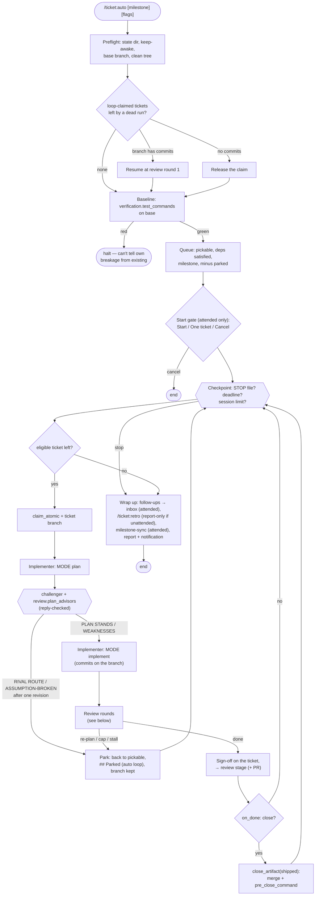
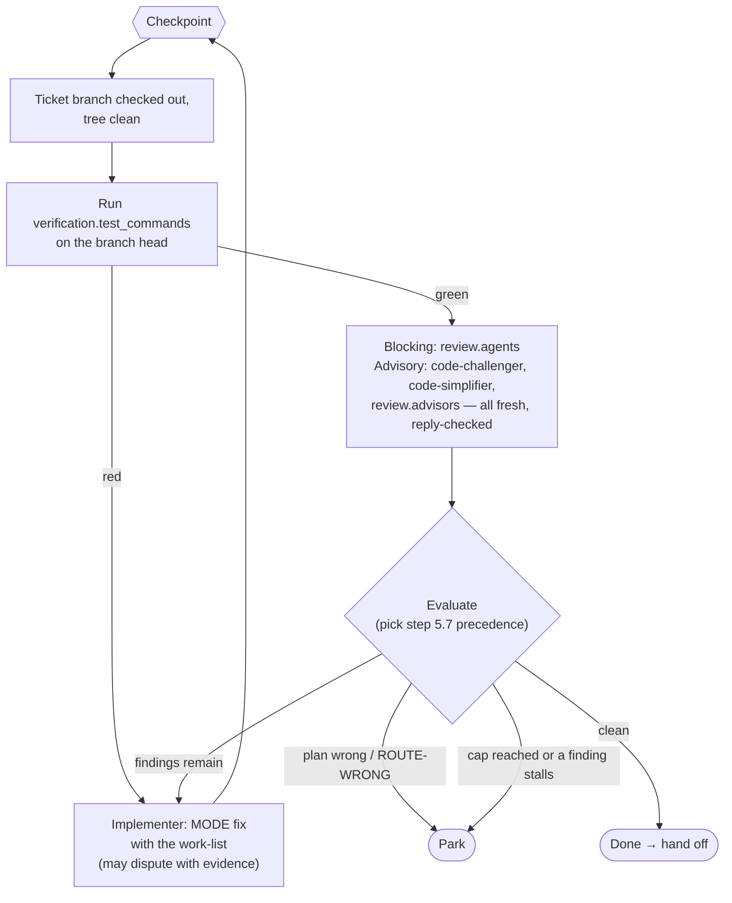

# `/ticket:auto`

*Codex: `$ticket-auto` · Antigravity / Gemini CLI / Copilot: `/ticket-auto`*

Runs [`/ticket:pick`](pick.md)'s implementation loop over a **whole
milestone**, one ticket after another, with no human at each gate. It can run
unattended overnight, and it picks up where it stopped after a crash, a usage
limit or a graceful stop.

Each ticket gets a **fresh implementer** subagent that plans, edits, tests and
commits on the ticket branch. Every review round dispatches the configured
review agents fresh. The session you started only **orchestrates**: it claims,
runs the suite, dispatches agents, weighs their verdicts and keeps the books.
It never reads or writes code, so its context stays small however long the run
gets.

A ticket ends the loop in one of two ways:

- **Handed off.** Approved: a Done evaluation over a green suite. It lands in
  the review stage with an `## Auto loop sign-off` section for a human to
  verify, or it is closed as shipped with `--close` / `auto.on_done: close`.
- **Parked.** Blocked, contested, or still failing review after the last
  round. It goes back to the pickable stage with the reason recorded under
  `## Parked (auto loop)`, and its branch is kept. Later runs skip it until a
  human looks at it.

A parked ticket never stops the loop. Only a broken environment does (a
**halt**), and the next run resumes it.

**Preconditions:** the same roles as `/ticket:pick`, plus
`git.branch_workflow: enabled` (a parked ticket's work has to stay off the
base branch).

## On Claude Code: a Workflow

On Claude Code the loop runs as a **Workflow**, a deterministic orchestration
script (`.claude/references/auto-workflow/ticket-auto.js`). The script decides
every next step: which ticket, which agent, iterate or park. It spawns three
kinds of agents:

- **Clerk agents** carry out the bookkeeping: claim, run the suite,
  reply-check and evaluate, sign off, park. Their operations are in
  `references/auto-workflow/clerk.md`.
- **The implementer**, fresh for each step.
- **The review agents**, dispatched by name.

Your session keeps the preflight, the gates and the wrap-up. A workflow can't
ask you anything, so a question an attended run needs comes back to the
session as `ask`. You answer it at a gate, and the session relaunches the
workflow at that ticket. Watch a run in `/workflows`.

The script's control flow is tested offline. `scripts/test-auto-workflow.sh`
runs it against scripted agents: no model, no tokens, 22 scenarios. Each
ticket costs roughly 20–30 agents, so a long milestone is best split with
`--max-tickets`.

**Other assistants.** Codex, Antigravity, Gemini CLI and Copilot have no
equivalent scripted-orchestration tool, so `/ticket-auto` runs the same loop
in the session itself. It dispatches the implementer and the review agents as
subagents where the assistant supports them, and follows them inline where it
doesn't. The steps and rules are the same.

## Arguments

| Argument | Meaning | Default |
| --- | --- | --- |
| `<milestone>` / `--all` | The milestone to run over, or the whole pickable stage | The current focus milestone from `references.roadmap` |
| `--max-rounds N` | Review rounds per ticket | `verification.max_loop_rounds` (3) |
| `--max-tickets N` | Session limit: stop after `N` tickets handed off or parked, so a fresh session continues | `0` (off) |
| `--unattended` | Nobody is watching: never ask. Owner questions and contested plans park instead | off |
| `--until HH:MM` | Local-time deadline, checked at each checkpoint | none |
| `--close` | Close approved tickets as shipped for this run | `auto.on_done` |
| `--keep-awake` | Hold the machine awake (`caffeinate` / `systemd-inhibit`) | on with `--unattended` |

## Top-level flow



## A review round

Each round starts with a checkpoint. The orchestrator runs the suite itself:
the implementer's own runs are its evidence, while this run is the loop's gate.
Agents never review a red diff.



Compared with `/ticket:pick`, the user gates are replaced by these rules:

| `/ticket:pick` gate | `/ticket:auto` |
| --- | --- |
| Plan gate (Approve / Edit / Abandon) | Approved when every challenger verdict is `PLAN STANDS` or `WEAKNESSES`. A `RIVAL ROUTE` or `ASSUMPTION-BROKEN` gets one revision. If it is still contested, an attended run asks you and an unattended run parks |
| Re-plan | Park. The loop never re-plans on its own |
| Escalation gate (Fix now / Waive / Abandon) | Park with the open findings. Only a human waives a blocking finding |
| An owner decision the implementer needs | Attended: asked as it comes up, and the answer is recorded under `## Owner decision`. Unattended: park |

## Run state

Everything lives in `.ticket-auto/` at the repo root. The loop adds it to
`.git/info/exclude`, so it never touches a tracked file:

- `run.log` holds one line per event and is the source of truth. After a
  context compaction, or in the next session, the loop re-reads it instead of
  trusting memory.
- `STOP`: `touch .ticket-auto/STOP` stops the run gracefully at the next
  checkpoint.
- `<id>/` holds the implementer's reports, each agent reply, and test-output
  tails.
- `followups.md` collects out-of-scope observations from implementers and
  agents. An attended wrap-up offers to capture them as inbox entries.
- `run.log` is also what [`/ticket:retro`](retro.md) measures a milestone from. The loop logs every gate a human answered (`gate`) and each suite run's seconds, as well as its other events.
- `report-<date>.md` is the final report: handed off, parked (with branches),
  left for resume, waiting, and what needs a human.

## Running it overnight

Start every run in a fresh session used for nothing else, because everything a
run needs is on disk:

```sh
claude -p "/ticket:auto v1.2 --unattended --until 07:00" 2>&1 | tee -a .ticket-auto/session.log
```

With `--max-tickets N`, loop until the report no longer starts with
`Session limit reached`. To resume after a crash or a usage limit, run the
same command again.

## Reads / writes

- **Claims:** `claim_atomic` per ticket, with the loop's own claims tracked in
  `run.log`. A ticket a person claimed is never touched.
- **Writes:** `update_frontmatter` (`## Owner decision`,
  `## Auto loop sign-off`), `transition_artifact` (to review, abandon to
  release, abandon with `keep_branch: true` to park), `close_artifact` with
  `--close`.
- **Branch:** one per ticket, from the run's base branch. A parked branch is
  kept for a human. With `--close`, the engine merges per
  `git.merge_strategy`, but only if base moved by ticket-state commits alone
  since the branch forked. Otherwise the close is held and the ticket waits in
  review.
- **Agents:** the implementer (a general-purpose subagent following
  `references/auto/implementer.md`), plus the same agents
  [`/ticket:pick`](pick.md) dispatches, each fresh per round.

## Exit states

| Outcome | Result |
| --- | --- |
| Handed off | In review (or in progress with no review stage) with a sign-off, or closed as shipped with `--close` |
| Parked | Back in pickable, `## Parked (auto loop)` appended, branch kept. Rename the heading or run `/ticket:pick <id>` to release it |
| Left for resume | Still claimed on its branch after a stop, deadline or halt. The next run resumes it |
| Close held | Approved and in review, but base moved by code or the merge conflicted |

## See also

- [`/ticket:pick`](pick.md) — the loop this command runs, one ticket at a time
- [Configuration reference § Auto loop](../config/reference.md#auto-loop) — `auto.on_done`
- [Shipped agents](../agents/index.md) — the agents every round dispatches
