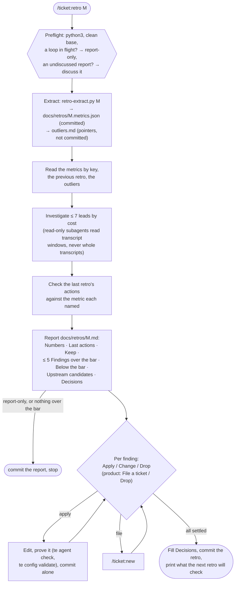

# `/ticket:retro`

*Codex: `$ticket-retro` · Antigravity / Gemini CLI / Copilot: `/ticket-retro`*

A retrospective on one finished milestone. It looks at **how** the milestone
was built, not what it built. It measures what the work cost, finds the few
process changes that would have saved the most, discusses each with you, and
applies the ones you accept. The next retro checks whether they worked.

It answers three questions:

| Dimension | What it measures | From |
| --- | --- | --- |
| **Tokens** | Cost by bucket (agents, the `/ticket:auto` orchestrator, attended sessions, overhead), per agent type, per ticket. Agents far above their type's median, contexts that grew or compacted, repeated commands and re-read files | Claude Code transcripts (sessions, subagents, Workflow agents) and Codex rollouts |
| **Time** | Claim → hand-off per ticket, suite seconds and red runs, review rounds | `.ticket-auto/run.log` |
| **Human in the loop** | Gates answered and how long each waited, owner questions, contested plans, parks, held closes, prompts typed to steer, rejects after a hand-off, how long handed-off work waited in review | `run.log`, the ticket history (git or `gh`), transcripts |

**Preconditions:** a config (`/ticket:init`), Python 3.9+ for the extractor
(standard library only), and a clean tree on the base branch.

## Flow

## The bar

A finding needs evidence from more than one place, or one expensive
occurrence. It also has to cost or risk at least one of these:

- 5% of the milestone's tokens;
- a review round, a park, a halt or a held close;
- a reject after a hand-off, meaning the loop's reviewers let a defect through;
- a human gate or owner question the process could have settled itself;
- an hour of human wait or of suite time.

At most five findings are discussed. The rest are listed one line each under
*Below the bar*, and a lead that shows up there twice in a row is promoted.

## What a change may touch

The retro changes **process**, never the product:

- **Bundle files:** commands, skills and references. Your edit survives
  `/ticket:init`'s update mode as a project change. A change that would help
  every project is listed under *Upstream candidates*.
- **Agents:** only their **user region**. Contract regions are fixed by the
  agent's kind, and generated regions belong to `/ticket:init`. A finding about
  a generated region proposes re-running init instead.
- **`config.yaml`:** for example verification commands, review agents,
  `max_loop_rounds`, NFR budgets or `auto.on_done`.
- **`CLAUDE.md` / `AGENTS.md`**, and the ticket template.

A change that lengthens an instruction says what it replaces. A change that
loosens a check says what that check caught and what will catch it instead. A
finding about the project's code or tests becomes a ticket through
`/ticket:new`.

## With `/ticket:auto`

[`/ticket:auto`](auto.md) runs the retro at wrap-up once its queue is empty.
It doesn't run it on a session stop, a `STOP`, a deadline or a halt, because
the milestone isn't finished then. An unattended run passes `--report-only`, so
the report waits for you, and you discuss it later by running `/ticket:retro M`
again. The loop logs what the retro measures: every gate a human answered,
each suite run's seconds, owner questions, parks and hand-offs.

A milestone built by hand with `/ticket:pick` has no run log. Pass
`--since`/`--until` to bound it, and the retro measures the sessions and
ticket history in that window.

## What it can't see

- **Assistants without a readable transcript.** Antigravity, Gemini CLI and
  Copilot contribute no token numbers, and the report's coverage line says so.
  Their time and human-in-the-loop numbers from the run log and ticket history
  still count.
- **Expired transcripts.** Claude Code deletes transcripts after 30 days by
  default. An optional `SubagentStop` hook keeps each agent's numbers past
  that; see `references/retro/format.md`.
- **Permission prompts.** These aren't recorded anywhere the extractor reads.
- **Rejects on the github backend.** These aren't counted yet.

## Reads / writes

- **Reads:** `.ticket-auto/run.log` in every checkout, the ticket history, and
  transcripts (read-only).
- **Writes:** `docs/retros/<M>.metrics.json` and `docs/retros/<M>.md`
  (committed), `.ticket-auto/retro/<M>/outliers.md` (not committed), and one
  commit per applied finding.
- **Never:** edits product code, applies an unsettled change, edits an agent's
  contract region, or commits a transcript path or excerpt.

## See also

- [`/ticket:auto`](auto.md): the loop whose run log the retro reads
- [Configuration reference](../config/reference.md): the keys a finding may change
- [Generated agents](../agents/generated.md): regions, and why the retro only edits the user region
